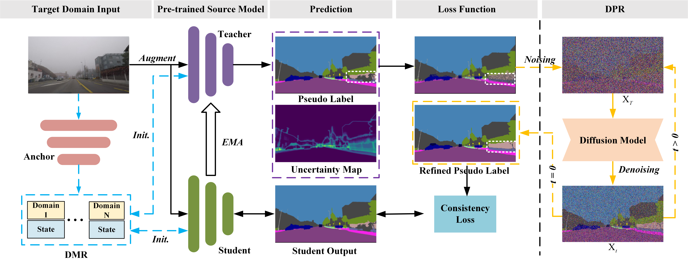

# Pseudo-label Refinement and Model-State Recovery for Continual Test-Time Adaptation on Semantic Segmentation

## Introduction
Official code for IJCV 2026 paper "[Pseudo-label Refinement and Model-State Recovery for Continual Test-Time Adaptation on Semantic Segmentation](https://doi.org/10.1007/s11263-026-03003-x)".
<p align="center">
  
</p>


## Environment setup
```
conda create -n prmr python=3.8 -y
conda activate prmr
pip install mmcv-full==1.7.1 -f https://download.openmmlab.com/mmcv/dist/cu116/torch1.12.0/index.html
pip install -r requirements.txt
```

## Prepare Dataset
ACDC could directly download it from [ACDC](https://acdc.vision.ee.ethz.ch/#about). 
Please set the acdc data_root in 
```
local_configs/_base_/datasets/acdc_1024x1024_repeat.py
```

## Prepare checkpoint
We use the pretrained SegFormer-B5 from here [Segformer](https://github.com/MLMIP/PRMR/releases/tag/v1.0.0/segformer.b5.1024x1024.city.160k.pth), and save in ./ckpt.

The diffusion model used in [here](https://github.com/MLMIP/PRMR/releases/tag/v1.0.0/diffusion_model.pt), and save in ./ckpt.
## Run
```
python3 tools/prmr.py
```


## Acknowledgement
Our code is based on [CoTTA](https://github.com/qinenergy/cotta), [SVDP](https://github.com/Anonymous-012/SVDP) and [CCDM](https://github.com/LarsDoorenbos/ccdm-stochastic-segmentation). Thanks them for releasing their codes.

## Citation
If you find our work is useful for your research, please consider citing:
```
@article{hu_pseudo-label_2026,
	title = {Pseudo-label Refinement and Model-State Recovery for Continual Test-Time Adaptation on Semantic Segmentation},
	volume = {134},
	number = {10},
	journal = {International Journal of Computer Vision},
	author = {Hu, Kai and Zhao, Zhihong and Zhang, Yuan and Gao, Xieping},
	year = {2026},
	pages = {448},
}
```


